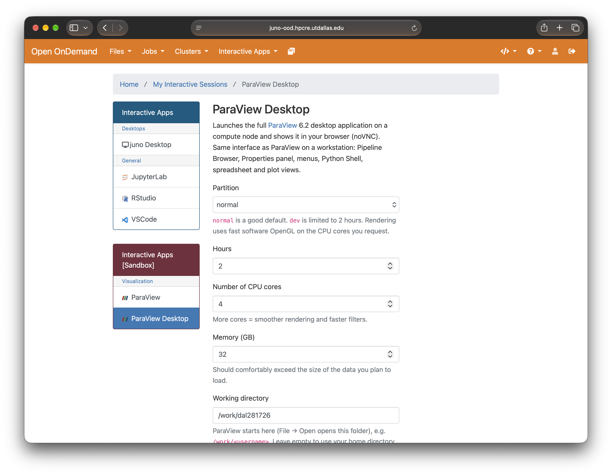
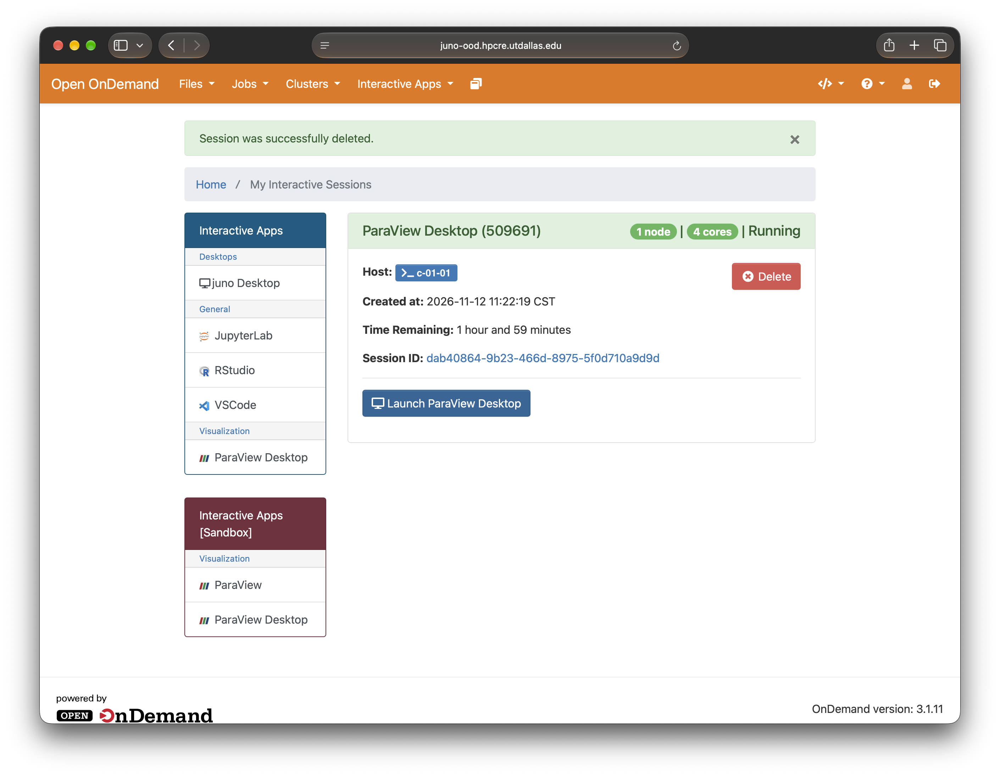
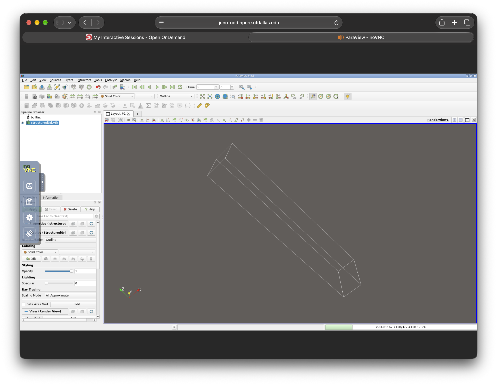
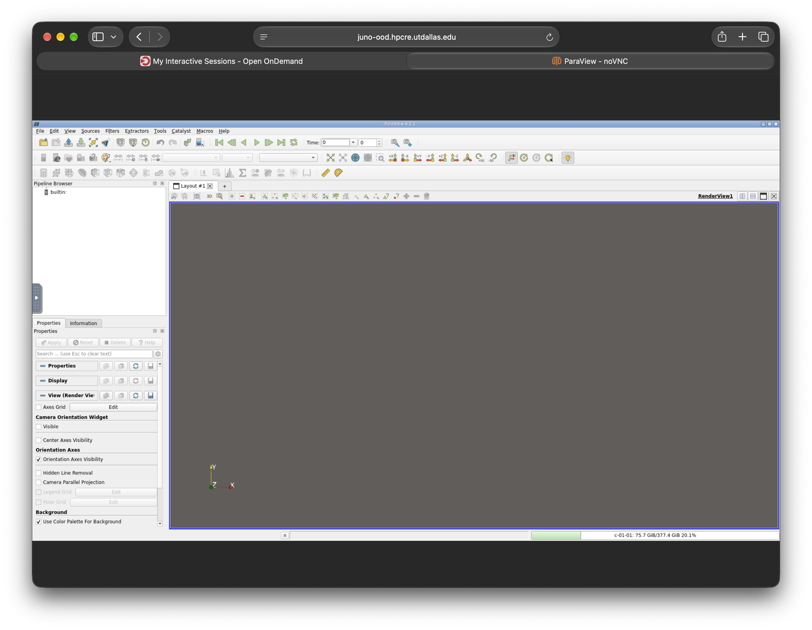
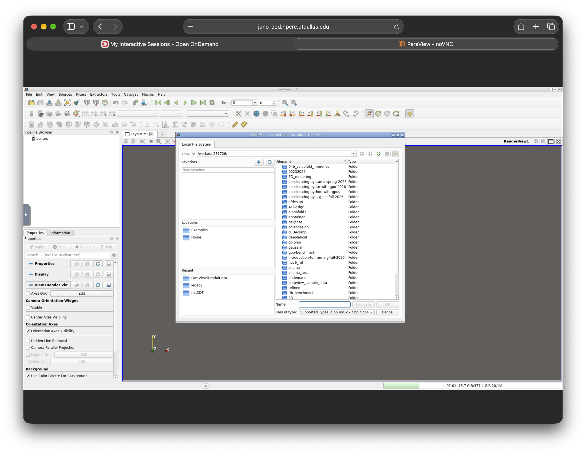

# ParaView on Juno

## Overview

[ParaView](https://www.paraview.org) is an open-source application for visualizing and analyzing large scientific datasets — meshes, volumes, simulation output, and time series.

On Juno, the **ParaView Desktop** app runs the full ParaView 6.2 application on a compute node and shows it in your browser. It is the same interface as ParaView on a workstation — Pipeline Browser, Properties panel, menus, toolbars, Python Shell, spreadsheet and plot views — but your data never leaves the cluster.

```
  Your browser  ◄──── screen / mouse / keyboard ────►  Open OnDemand  ◄────►  Compute node
  (any laptop)                                         (web portal)           (ParaView 6.2: reads data,
                                                                               filters, renders)
```

> **No installation needed:** you don't need ParaView, VNC software, or SSH on your own computer. A modern web browser (Chrome, Firefox, Edge, Safari) is enough.

---

## Launching ParaView Desktop

Open OnDemand launches ParaView for you through a web form. No SSH tunneling or software installation required.

### Step 1 — Open the portal

Go to [https://juno-ood.hpcre.utdallas.edu/](https://juno-ood.hpcre.utdallas.edu/) and log in with your NetID.

> **Off-campus users:** connect to the UT Dallas VPN before accessing the portal.

### Step 2 — Request a ParaView session

1. Click **Interactive Apps** in the top menu bar.
2. Select **ParaView Desktop**.
3. Fill in the resource form:

| Field | Typical value | Notes |
|---|---|---|
| Partition | `normal` | `dev` for short tests (max 2 hours). GPU partitions are not required |
| Hours | 2–4 | Max 48 |
| Number of CPU cores | 8 | More cores = smoother rendering and faster filters |
| Memory (GB) | 32 | At least 2–3× the size of the files you load |
| Working directory | `/home/<netID>/work` _(optional)_ | Where **File → Open** starts. Empty = your home directory |
| Desktop resolution | `1920x1080` | Use `2560x1440` on large or high-resolution monitors |



4. Click **Launch**.

> **Do I need a GPU?** No. ParaView renders in software using the CPU cores you request, which works well for most datasets. If interaction feels slow, request more cores rather than a GPU partition.

### Step 3 — Connect

Your session appears under **My Interactive Sessions** and moves through **Queued → Starting → Running**. Once the job is scheduled, the desktop is usually ready within a few seconds.

When the session shows **Running**, click **Launch ParaView Desktop**. ParaView opens in a new browser tab.



The first time ParaView starts, a **Welcome to ParaView** window appears. Click **Close** (check **Don't show this window again** to skip it next time).

> **Session persistence:** if you close the browser tab or lose your connection, ParaView keeps running and your work is preserved. Return to the portal, click **My Interactive Sessions**, and click **Launch ParaView Desktop** again.

> **Keep the link private:** the launch link contains your session password. Anyone with the link can control your session, so don't share it.

---

## Browser display controls (noVNC)

ParaView is shown through **noVNC**, a remote display viewer that runs in your browser. Its control panel is hidden behind the small tab on the **left edge** of the window. Click the tab to open it.



| Button | Use it to |
|---|---|
| **Extra keys** | Send keys your browser would otherwise catch, such as **Ctrl**, **Alt**, **Tab**, **Esc** |
| **Clipboard** | Copy and paste text between your computer and ParaView (see below) |
| **Full screen** | Use the whole monitor for ParaView |
| **Settings** | Scaling mode, **Quality**, and **Compression level** |

**Copying and pasting text:**

- *Your computer → ParaView:* open **Clipboard**, paste your text into the box, then paste in ParaView with **Ctrl+V**.
- *ParaView → your computer:* copy in ParaView with **Ctrl+C**. The text appears in the **Clipboard** box, where you can copy it.

> **Display feels slow or blurry?** Open **Settings** and lower **Quality** or raise **Compression level** on slow connections. Raise **Quality** on fast connections for sharper images.

> **Careful with browser shortcuts:** some keyboard shortcuts, such as **Ctrl+W** (close tab), go to your browser instead of ParaView. Use **Full screen** mode or the **Extra keys** panel to avoid them.

---

## Using ParaView

### The interface at a glance



| Area | What it does |
|---|---|
| **Menu bar** (top) | **File**, **Edit**, **View**, **Sources**, **Filters**, **Tools**, **Help** |
| **Toolbars** | Common actions: open, coloring, representation, camera, time controls |
| **Pipeline Browser** (top left) | Everything you have loaded or computed. The eye icon toggles visibility |
| **Properties panel** (bottom left) | Settings for the selected item: filter parameters, display, view |
| **Render View** (right) | The 3D view. Drag to rotate, scroll to zoom |

### Step 1 — Open a data file

1. Click **File → Open** (or the folder icon in the toolbar).
2. Browse to your data and click **OK**.
3. Click **Apply** in the **Properties** panel. The data appears in the Render View.



> **The file dialog shows the cluster, not your computer.** **File → Open** browses Juno's filesystems (your home directory, `~/work`, `~/scratch`, `/groups/<pi-name>`). To use data from your own computer, first upload it with the portal's **Files** menu, then open it in ParaView.

> **Nothing appears?** ParaView doesn't read the file until you click **Apply**. The **Apply** button turns green whenever there are changes waiting.

Supported formats include VTK (`.vtk`, `.vtu`, `.vti`, `.vtp`, `.pvd`), Exodus (`.e`, `.ex2`, `.exo`), netCDF (`.nc`), HDF5/XDMF (`.xmf`), CGNS, OpenFOAM (`.foam`), EnSight, PLY, STL, OBJ, CSV, and many more.

### Step 2 — Color and display your data

With an item selected in the **Pipeline Browser**:

- **Color by an array:** choose it from the coloring drop-down in the toolbar (it shows **Solid Color** by default), for example `Temp`.
- **Change the representation:** choose **Surface**, **Surface With Edges**, **Wireframe**, **Points**, **Outline**, or **Volume** from the representation drop-down next to it.
- **Edit the color map:** click the **Edit Color Map** button in the toolbar, or open the **Display** section of the **Properties** panel.


### Step 3 — Apply filters

1. Select the item to filter in the **Pipeline Browser**.
2. Open the **Filters** menu and choose a filter, or press **Ctrl+Space**, type the filter name, and press **Enter**.
3. Adjust its settings in the **Properties** panel and click **Apply**.

Commonly used filters:

| Filter | What it does |
|---|---|
| **Contour** | Iso-surfaces of a scalar (e.g. temperature = 500) |
| **Slice** | Cuts the data with a plane |
| **Clip** | Removes everything on one side of a plane |
| **Threshold** | Keeps cells whose values fall in a range |
| **Glyph** | Draws arrows for vector fields |
| **Stream Tracer** | Streamlines through a vector field |
| **Warp By Vector** | Deforms the mesh by a displacement field |
| **Calculator** | Computes a new array from an expression |
| **Plot Over Line** | Plots values along a line in a chart view |


### Step 4 — Interact with the 3D view

| Action | Mouse |
|---|---|
| Rotate | Left-click and drag |
| Pan | Middle-click and drag, or Shift + right-drag |
| Roll (spin in the screen plane) | Shift + left-drag |
| Zoom | Scroll wheel, or right-click and drag |
| Reset camera | **Reset Camera** button in the camera toolbar |

### Step 5 — Time-dependent data

For datasets with multiple time steps, use the **VCR controls** in the toolbar (▶ play, ⏮ first, ⏭ last, step forward/back) or type a time step in the **Time** box.


### Step 6 — Save your work

| To save… | Use | Notes |
|---|---|---|
| An image | **File → Save Screenshot** | Saved on the cluster (e.g. in `~/work`) |
| A movie | **File → Save Animation** | PNG frame series or `.avi`, saved on the cluster |
| Processed data | **File → Save Data** | Writes the selected pipeline item to a file |
| Your whole session | **File → Save State** (`.pvsm`) | Reload later with **File → Load State** |

> **Files are saved on Juno, not your computer.** To copy images or movies to your computer, use the portal's **Files** menu and click **Download**.

### Step 7 — End your session

Click **File → Exit** in ParaView. This ends the job and releases the compute node. You can also click **Delete** on the session in **My Interactive Sessions**.

> **Closing the browser tab does not stop the job.** The session keeps running (and counting against your allocation) until you exit ParaView, delete the session, or it reaches its time limit.

---

## Python and batch processing

ParaView's Python tools are available both inside the app and in batch jobs.

- **Python Shell:** **View → Python Shell** gives you an interactive Python prompt connected to your current session.
- **Record a script:** **Tools → Start Trace**, do your work in the GUI, then **Tools → Stop Trace**. ParaView writes the equivalent Python script for you.

Run a recorded script without the GUI as a SLURM batch job (not on the login node):

```bash
#!/bin/bash
#SBATCH -J pv-batch
#SBATCH -p normal
#SBATCH -N 1
#SBATCH -n 8
#SBATCH --mem=32G
#SBATCH -t 01:00:00

module load paraview
srun pvbatch my_script.py    # batch rendering across 8 MPI ranks
# pvpython my_script.py      # serial alternative
```

Submit it with `sbatch pv-batch.sh`. See [SLURM Job Scheduler](../running-programs/slurm.md) for details.

> **Tip:** tracing is the fastest way to automate a visualization. Build it once in the GUI, save the trace, and re-run it on many datasets or time steps in batch.

---

## Troubleshooting

> **Session ends immediately or never reaches Running?** Click the **Session ID** link on the session card and open `output.log`. Common causes are requesting more memory or cores than the partition allows, or a time limit above the partition maximum (`dev` is limited to 2 hours).

> **"Disconnected" or a blank screen in the browser?** Reload the tab. If that doesn't help, return to **My Interactive Sessions** and click **Launch ParaView Desktop** again. If the session card shows **Completed**, ParaView was closed or the job reached its time limit. Start a new session.

> **ParaView closed and my session ended?** Exiting ParaView ends the job by design. Save your work with **File → Save State** before exiting so you can reload it next time.

> **Out of memory / ParaView crashes while loading data?** Delete the session and relaunch with more **Memory (GB)**. As a rule of thumb, request at least 2–3× the size of the files you load.

> **Rendering is slow?** Request more CPU cores. Also try reducing the data first with **Slice**, **Extract Surface**, or **Threshold**, or lower the **Quality** setting in the noVNC panel.

---

## Need Help?

- **Email:** [circ-assist@utdallas.edu](mailto:circ-assist@utdallas.edu)
- **Open OnDemand issues:** include the session ID shown in "My Interactive Sessions" and the contents of `output.log`
- **Data loading issues:** include the file format, file size, and the exact error message

## Related guides

- [Open OnDemand →](open-ondemand.md)
- [Launching GUI Programs (X11) →](gui-programs.md)
- [JupyterLab on Juno →](jupyter.md)
- [Storage & Data Transfer →](../getting-started/storage.md)
- [SLURM Job Scheduler →](../running-programs/slurm.md)
